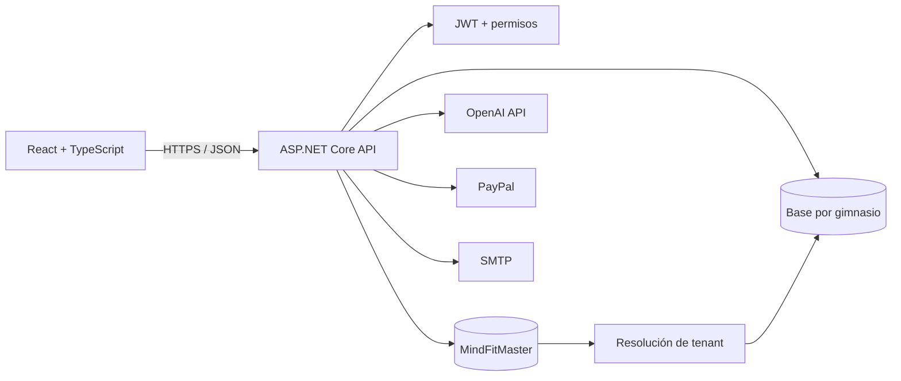

<p align="center">
  
</p>

# MindFit Intelligence

Plataforma web multi-tenant para administrar gimnasios, socios, turnos, rutinas y reportes desde un único sistema. Incluye asistencia de IA para proponer rutinas que siempre deben ser revisadas y guardadas por un entrenador.

> Proyecto de portfolio / demostración técnica. No contiene credenciales, bases productivas ni datos personales reales.

<p align="center">
  
</p>

## Funcionalidades principales

- Registro y aprovisionamiento automático de gimnasios.
- Aislamiento multi-tenant mediante una base SQL Server por gimnasio.
- Autenticación JWT, grupos y permisos granulares.
- Gestión de socios, responsables, turnos, cupos y cuotas.
- Catálogo de ejercicios, equipamiento, máquinas y horarios.
- Creación e historial de rutinas.
- Sugerencias de rutinas asistidas por IA con revisión humana.
- Auditoría de operaciones, indicadores y exportación de reportes a PDF.
- Portal del socio y administración de suscripciones mediante PayPal.

## Arquitectura



La base maestra registra gimnasios y resuelve la conexión de cada tenant. Cada gimnasio opera sobre su propia base, creada mediante migraciones de Entity Framework Core y datos estructurales iniciales.

Más detalles en [Arquitectura](./docs/architecture.md).

## Stack

| Área | Tecnologías |
| --- | --- |
| Frontend | React 19, TypeScript, Vite, React Router, Recharts, jsPDF |
| Backend | ASP.NET Core 10, Entity Framework Core, FluentValidation, AutoMapper |
| Seguridad | JWT, autorización por políticas y permisos |
| Datos | SQL Server, migraciones EF Core, arquitectura multi-tenant |
| Integraciones | OpenAI, PayPal y SMTP |

## Estructura

```text
.
├── backend/     API, migraciones y herramientas de verificación
├── frontend/    aplicación React
├── docs/        arquitectura, configuración y guías funcionales
└── .github/     integración continua y actualizaciones de dependencias
```

## Ejecución local

### Requisitos

- .NET SDK 10.0.301 o compatible.
- Node.js 24 y npm 11.
- SQL Server Express o Developer.
- `dotnet-ef` 10.x para administrar migraciones.

### 1. Configurar el backend

Nunca copies credenciales dentro de `appsettings.json`. Usa .NET User Secrets, variables de entorno o un `appsettings.Local.json` ignorado por Git.

```powershell
cd backend\MindFit_Intelligence_Backend
dotnet restore
dotnet user-secrets set "ConnectionStrings:MasterConnection" "TU_CONEXION_MASTER"
dotnet user-secrets set "ConnectionStrings:StoreConnection" "TU_CONEXION_FALLBACK"
dotnet user-secrets set "ConnectionStrings:TenantTemplate" "TU_PLANTILLA_CON_{0}"
dotnet user-secrets set "AppSettings:Token" "UN_SECRETO_JWT_LARGO_Y_ALEATORIO"
```

Las integraciones externas son opcionales para navegar el proyecto. Sus variables están detalladas en [Configuración](./docs/configuration.md).

### 2. Crear las bases locales

```powershell
dotnet ef database update --context MindFitMasterContext
dotnet ef database update --context MindFitIntelligenceContext
```

### 3. Levantar la API

```powershell
dotnet dev-certs https --trust
dotnet run --launch-profile https
```

Swagger queda disponible en `https://localhost:7199/swagger`.

### 4. Levantar el frontend

En otra terminal:

```powershell
cd frontend
npm ci
npm run dev
```

Vite publica la aplicación en `http://localhost:5173` y redirige `/api` hacia la API local.

La guía completa está en [Desarrollo local](./docs/local-development.md).

## Verificación

```powershell
dotnet build backend\MindFit_Intelligence_Backend.sln --configuration Release
npm --prefix frontend ci
npm --prefix frontend run lint
npm --prefix frontend run build
```

GitHub Actions ejecuta estas comprobaciones en cada push y pull request.

## Documentación

- [Arquitectura multi-tenant](./docs/architecture.md)
- [Configuración segura](./docs/configuration.md)
- [Desarrollo local](./docs/local-development.md)
- [Asistente de rutinas con IA](./docs/features/ai-routine-assistant.md)
- [Política de seguridad](./SECURITY.md)

## Estado y alcance

El repositorio representa un proyecto académico y de portfolio. Algunas integraciones requieren cuentas sandbox o credenciales propias; no se incluyen datos productivos ni una demo pública preconfigurada.

## Uso del código

Este repositorio se publica con fines de evaluación y portfolio. Al no incluir una licencia de código abierto, no se conceden permisos de copia, redistribución o uso comercial.

Desarrollado por **Nico Di Domenico**.
