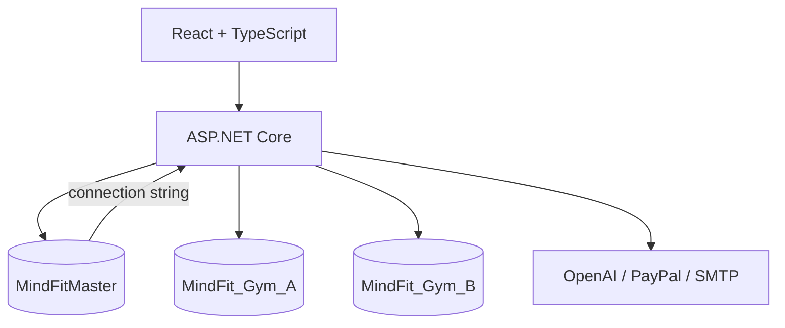
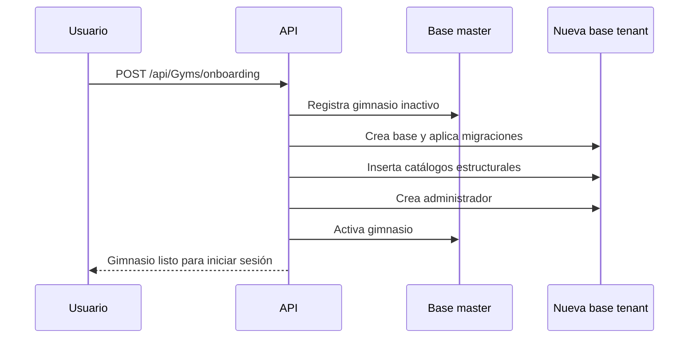

# Arquitectura

MindFit Intelligence utiliza una arquitectura web separada en frontend, API y persistencia multi-tenant.

## Componentes

### Frontend

La aplicación React consume `/api`, administra la sesión JWT y adapta la navegación a los permisos efectivos del usuario. Incluye áreas públicas, administración del gimnasio y un portal específico para socios.

### API

La API organiza la lógica en controladores, servicios, repositorios, validadores y middleware. La autorización combina JWT con políticas y permisos persistidos por tenant.

### Base maestra

`MindFitMaster` conserva la identidad del gimnasio, el usuario master, el estado de la suscripción y la conexión correspondiente. No contiene la información operativa completa de los socios.

### Bases tenant

Cada gimnasio utiliza una base separada. El tenant se resuelve a partir de la solicitud y se expone mediante un contexto scoped. Turnos, usuarios, rutinas, cuotas y catálogos operan sobre esa conexión.

## Aprovisionamiento de un gimnasio

El aprovisionador rechaza bases ya existentes y no ejecuta eliminaciones automáticas. Los datos iniciales usan claves naturales y el seed es idempotente.

## Decisiones de seguridad

- Las credenciales se obtienen desde User Secrets, variables de entorno o configuración local ignorada.
- Las contraseñas se persisten mediante hashing; nunca se documentan ni registran en texto plano.
- La IA propone contenido, pero no persiste cambios sin una acción explícita del entrenador.
- Los gimnasios inactivos no son resolubles como tenants válidos.
- Los dumps y backups de bases no forman parte del repositorio público.
